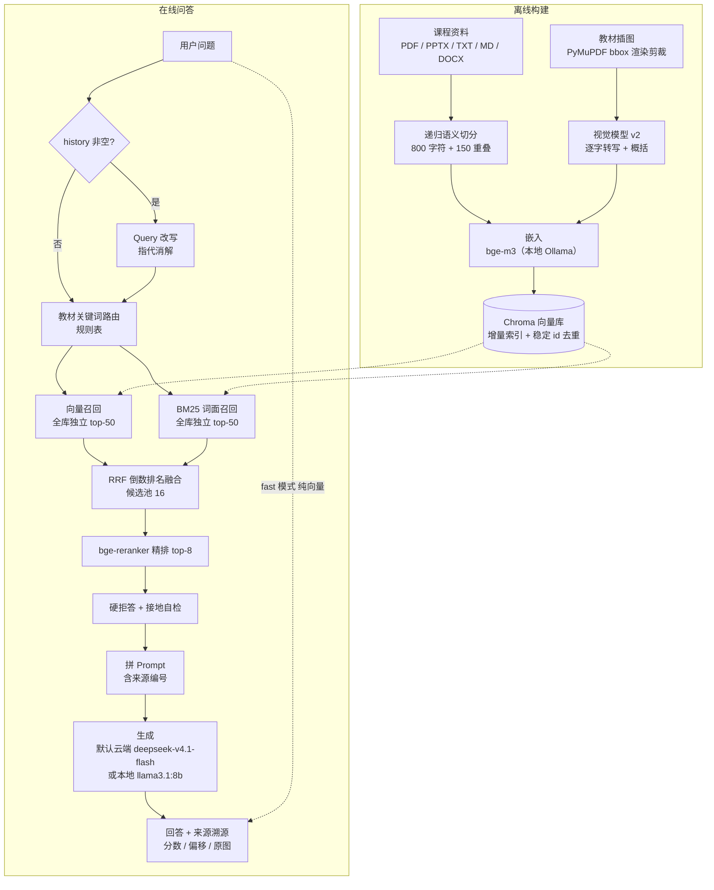

# CourseRAG · 论文库问答（v2.1）


一个垂直领域 RAG 问答应用，面向「计算机／数学专业课、课本知识问答」场景：
把课程笔记与教材 PDF/PPTX 建成知识库，提问时给出**带来源引用**的回答，答案可回溯到具体段落与教材原图。

**运行模式（2026-10 起）**：嵌入（Ollama bge-m3）与精排（sentence-transformers）留在本机。
论文库（默认 profile）走**本地生成 `qwen2.5:7b`**，**生成后接地复核默认关闭**（8 GB 卡装不下第二个裁判模型）；
课程版（v1.1）仍默认云端生成/裁判，可随时切回全本地。
换原因很简单：本机只有 8 GB 显存，生成模型 + 另一个裁判模型装不下，
Windows WDDM 不报 OOM，而是把 CUDA 调用挂住（日志长时间无输出、CPU 仍上涨）。
仍可用 `LLM_PROVIDER=ollama` + `JUDGE_PROVIDER=local` 切回全本地，代价是显存与延迟。

> ⚠️ **数据边界**：切云端后，**用户问题与检索到的正文会发送给中转 API**；嵌入阶段不出本机。
> 需要严格「数据不出本机」时，请把 `LLM_PROVIDER` 与 `JUDGE_PROVIDER` 都设为本地。

RAG 核心（切分 / 加载 / 嵌入 / 向量检索 / 词面检索 / 融合 / 精排 / 接地自检）与评估体系均为自实现，
RAG 核心链路直接依赖仅 `ollama` + `chromadb` + `sentence-transformers` 三项，已彻底移除 LangChain 全家桶
（完整运行依赖见 `requirements.txt`，共 10 项直接依赖）。

## 论文库模式（v2.1，默认 `APP_PROFILE=paper`）

把「课程笔记 RAG」改成「论文库 RAG」：MinerU 解析 PDF → 页/块结构 → 页内切分 → 索引，
回答与引用**精确到《论文名》第 N 页**，点引用可看该页渲染图并高亮原文块。
课程版仍在：`APP_PROFILE=course` 切回原链路（索引 `chroma_db_m3` / 集合 `course_rag`）。

### 快速开始

```bash
# 1) 仅 MinerU 用独立 venv（主环境不 import mineru）
python -m venv venv-mineru            # Python 3.10–3.13
venv-mineru/Scripts/pip install "mineru[pipeline]==2.7.6"
# 中文用户名/中文仓库路径下 fasttext 打不开 Unicode 路径时，改建到 ASCII 盘：
#   python -m venv E:\mineru_venv
# 并在 .env 设 MINERU_PYTHON=E:/mineru_venv/Scripts/python.exe

# 2) 主环境依赖 + 启动
pip install -r requirements.txt       # 含 pymupdf，Streamlit 页图渲染用
ollama serve
streamlit run app.py                  # 论文库 UI（默认 paper profile）
uvicorn main:app --host 127.0.0.1 --port 8000

# 3) 解析 + 索引（CLI 与 UI/API 等价）
python paper_ingest.py --dir data/papers/raw --only-new   # MinerU 解析 → normalized
python paper_index.py --rebuild                            # normalized → 1341 块（18 篇 + 18 条元信息块，1200 字切分）
python paper_index.py --audit                              # 100% 有页 / 0 跨页
```

React 前端（可选，Streamlit 已覆盖同一链路）：

```bash
cd frontend
npm install
npm run dev          # http://127.0.0.1:5173，/api 代理到 127.0.0.1:8000
```

聊天接口流式走 POST + `fetch`/`ReadableStream`（不用 `EventSource`，因其不支持自定义请求体与请求头）。

### 目录与数据边界

```
data/papers/
├── raw/          # 原始 PDF（gitignored，不提交）
├── parsed/<id>/  # MinerU 输出（content_list.json / middle.json / *_origin.pdf）
├── normalized/   # paper_blocks/1 JSON（bbox 统一为 PDF 点）
├── meta/         # 标题/作者/年限/URL/许可/sha256
├── _state/       # 状态机真源（discovered→queued→parsing→parsed→normalized→indexed/failed）
└── manifest.csv  # 由 state 派生
```

- `paper_id = sha256[:12]`；重复上传按 sha256 去重，`--only-new` 命中缓存不重解析。
- **不提供整本 PDF 下载**：只有 `/papers/{id}/pages/{page}.png` 页图（可选 bbox 高亮）。
- 解析失败只记 `failed`，不静默降级（`PAPER_FALLBACK_ENABLED=true` 才会走 pdftext 兜底）。

### 接口（FastAPI）

| 方法 | 路径 | 说明 |
|---|---|---|
| POST | `/papers` | 批量上传 PDF，落盘入队，返回 `queued`；单 worker 逐篇解析 |
| GET | `/papers` / `/papers/{id}` | 列表 / 详情（状态、页数、块数、耗时） |
| POST | `/papers/{id}/reparse` | 重解析（先删该 sha 的索引） |
| DELETE | `/papers/{id}?delete_raw=` | 删索引与状态；`delete_raw=true` 才删 PDF |
| GET | `/papers/{id}/blocks?page=n` | 归一化块（类型/文本/bbox/章节） |
| GET | `/papers/{id}/pages/{page}.png?blocks=b1,b2` | 页图 + 红框高亮 |

MCP 出口：`paper_retrieve`（论文库主入口）、`list_documents`；`course_retrieve` 保留为课程兼容别名。
Streamlit 侧引用卡直接显示「《标题》第 N 页 · 章节」+ 页图。

### 论文库实测（2026-10-29，18 篇 / 289 页 / 1324 块正文 + 18 条元信息块 / 1200 字切分 / bge-m3 + bge-reranker-v2-m3）

- 语料：18 篇开放获取论文（RAG / DPR / FiD / ColBERT / Sentence-BERT / BGE-M3 / HyDE / Self-RAG /
  RAGAS / GraphRAG / Lost in the Middle / RAG 综述 / MinerU / Seven Failure Points / QLoRA 等），
  来源与许可逐篇记在 `data/papers/meta/<sha256>.json`；PDF 不提交。
- 归一化：18/18 成功（含中文论文），2834 块；`--audit` = 1324 块、**缺页 0、跨页 0**、缺章节 20（1.5%）。
- 页级评测（**2026-10-30 扩题：30 题覆盖全部 18 篇**，检索池 18 篇）：
  **paper_hit@8 = 1.000（30/30）、page_hit@8 = 0.967（29/30）、page_strict@1 = 0.700（21/30）**（题名路由开启）。
  其中原 15 题（只覆盖 3 篇）子集仍为 1.000 / 1.000 / 0.867；**新增 15 题（每篇 1 题，11 题首页 + 4 题深页）
  明显更难**。
  路由 A/B（同 30 题）：关闭 `PAPER_TITLE_ROUTING_ENABLED` 时为 **0.967 / 0.900 / 0.700**，
  开启只修正两题（HyDE 绕开精排 0.159 误杀、FiD 绕开向量 0.379 漏召回），其余题检索结果不变。
  旧读数（15 题）偏乐观：它只覆盖原 3 篇，且这 3 篇各有 5 题、阈值与题集同源。
  扩容前（3 篇 / 198 块）同一题集为 1.000 / 1.000 / 0.933。
- 切分 A/B（page_hit@8 / page_strict@1，仅在原 3 篇上做过）：600 → 0.933/0.800；800 → 0.933/0.867；
  **1200 → 1.000/0.933（胜者，已设默认）**；18 篇下未重做切分 A/B。
- 拒答门控（20 域外 + 20 域内，18 篇池，1200 切分）：**拒答 90%（18/20）、域内误拒 0%（0/20）**。
  这是**纯阈值口径**（只看向量/精排分，不含生成后接地复核——paper 下该复核默认关闭）。
  注意这 20 道域内题与阈值标定同源，**不能当作全域内误拒率**：扩到 30 题页级集后暴露 **2/30 = 6.7%**
  （HyDE：检索到正确页但精排 0.159 < 0.20 被误杀；FiD：向量 0.379 < 0.40，召回到错篇）。
  题名路由（v3.2）上线后同一 30 题为 **0/30**（`PAPER_TITLE_ROUTING_ENABLED=false` 可复现 2/30）。
  两道漏拒：`BERT 的 MLM 预训练目标`（vec 0.702 / rerank 0.740，召回的 ColBERT 相关工作是"提到 BERT"而非"解释 MLM"）、
  `Mamba 架构差异`（0.478 / 0.341）。两者与域内最低分（0.486 / 0.290）重叠，**阈值不可分**，只能靠接地判官兜。
- 负样本重标（2026-10-29）：原「RAG 如何融入生成」「Llama 2 的 MMLU」已被新收录论文真正覆盖，
  替换为 DoRA / KTO 两题（实测 0.586/0.183、0.000/0.001，均被拒）；改动写在 `eval_data_paper.py` 注释里。
  因此**旧的「95%」与新的「90%」不是同一题集，不可直接对比**。
- held-out（10 + 10，只跑一次）：
  - 3 篇 / 800 切分（历史）：域外拒答 100%，**域内误拒 20%（2/10，检索未命中）**；
  - 18 篇 / 1200 切分（2026-10-30）：域外拒答 **100%（10/10）**，
    域内误拒 **10%（1/10）**——`中文论文的作者与发表期刊是什么？` 被精排 0.133 < 0.20 拦下。
  - **路由后再跑一次（2026-11-02）**：域外 **100%（10/10）**、域内误拒 **10%（1/10）**，
    仍是同一题，精排 **0.1327**（向量 0.564 过阈）。它不含论文自称缩写，题名路由不覆盖；
    该题问的是作者/期刊这类页面元信息，精排分天然低。
  - 三次均**未达 5% 误拒目标**，且按纪律跑完不回调阈值。
  - **元信息块修复（2026-11-02）**：`paper_chunker.metadata_chunk()` 每篇生成一条
    `block_type=metadata` 的短块（标题 / 作者 / 发表期刊 / 年份）。该题精排分 **0.133 → 0.846**，
    端到端答出「邢淼、田丽，《知识管理论坛》」并引到第 1 页；30 题页级（1.000 / 0.967 / 0.700）
    与拒答门控（90% / 0%）无变化。**未整组重跑 held-out**（第三次看答案会失去留出意义）。
- 三阈值（论文库专用，非课程值）：`PAPER_HARD_REJECT_VECTOR_THRESHOLD=0.40`、
  `PAPER_HARD_REJECT_RERANK_THRESHOLD=0.20`、`PAPER_LOW_CONFIDENCE_THRESHOLD=0.50`。
  扩容到 18 篇后仍为 90% / 0%，未重标；上方两道漏拒说明这三个阈值已到顶-1 分数的分辨上限。
- 解析耗时（GPU，含模型加载）：15 页 70.2s / 26 页 95.7s / 11 页 66.1s；
  同篇 10 页 CPU 153s vs GPU 78s，峰值显存 5457 MiB。18 篇全量解析约 30 分钟。
- 切分 A/B（600/800/1200）读数见 `CourseRAG-实现记录.md`（仓库外）。

### 回答质量四指标（P1，2026-10-30；30 题口径 2026-11-02）

`eval_paper_quality.py` 两段式：`--stage generate`（qwen2.5:7b 答题）→ `ollama stop` →
`--stage judge`（glm4:9b 打分，直接复用 `eval_local` 四指标）；引用另跑
`--stage citecheck`（glm4:9b 判「带 `[n]` 的句子是否被第 n 条 chunk 支持」）。

**30 题全套（2026-11-02，题名路由开启，0 题硬拒，CSV `*_20261102_111258_*`）**：

| 指标 | 30 题 | 15 题子集（2026-10-30，归一化后） |
|---|---|---|
| faithfulness | **0.763**（5/30 为 0） | 0.603 |
| answer_relevancy | 1.000（30/30 满分，**对本库无判别力**） | 1.000 |
| context_precision | **0.836** | 0.801 |
| context_recall | **0.667**（9/30 为 0） | 0.633 |
| answer_cite_page_acc | **0.633（19/30）** | 0.867（13/15） |

- 30 题 faithfulness 比 15 题高、recall 持平，原因是新增题多为"原文数字/事实"型，断言少、更容易被支持；
  **15 题与 30 题不是同一题集**，不要横向比较趋势。
- 15 题历史读数（归一化前 0.672 / 1.000 / 0.802 / 0.633 / 0.800）保留在实现记录里。
- **引用（30 题，2026-11-02）——四个口径并列，不能互相替代**：

  | 口径 | 定义 | 读数 |
  |---|---|---|
  | `cite_page_strict` | `[n]` → 该 chunk 页码命中人工登记的**首次出现页** | **0.633（19/30）** |
  | `cite_page_support` | 被引**页**本身是否含证据（关键词核验） | **0.967（29/30）** |
  | `cite_supported_single` | 被引**chunk**（模型原指那块）是否支持该句 | 0.612 句级（30/49）/ 0.467 整题（14/30） |
  | `cite_supported_union` | 被引**页上本轮召回的全部块**是否支持该句（v3.3 高亮范围） | **0.735 句级（36/49）/ 0.667 整题（20/30）** |

  人工复核（同样的 13 条 union 也不支持的句子）：3 条判官假阴性（HTML 表格）、3 条部分支持、
  1 条无实质陈述、6 条真不支持（Q2/Q5/Q10×3/Q26：证据在本页**未被召回**的块或别的页）。
  复核后：`single` **0.688 句级（33/48）/ 0.567 整题（17/30）**，
  `union` **0.813 句级（39/48）/ 0.767 整题（23/30）**。
- v3.3 起 `build_citations()` 把**同一论文同一页的已召回块**并入 `block_ids`（编号、卡片顺序、`[n]` 语义不变），
  页图高亮因此覆盖同页证据：6 条"被引块不支持"的句子在合并后变为支持（Q1 的 28.4、Q7 的 Wq/Wv、
  Q8 的 r=1、Q14 的维度列表、Q25 的零样本、Q30）。人工抽 5 条页图（Q1/Q18/Q26/Q28/Q29）确认证据在框内。
  **`single` 不变差、也不因合并而变好**：它衡量的"归因错误率"仍然存在（模型把句子挂到隔壁块）。
- 0.633 是**严格下界**（事实在别页重复、命中也不算），不是真实错误率；0.967 说明"引到的那一页确实有答案"。

- 归一化指 MinerU 公式数字拆字修复（`$0 . 9 8$` → `$0.98$`）：数学段内拆字已归零，索引 1324→1323 块；
  2026-11-02 加元信息块后为 **1341 块**（1323 正文 + 18 元信息）。
  检索层不受影响：paper_hit@8 1.000 / page_hit@8 1.000 / strict@1 0.867；拒答 90% / 域内误拒 0%。
- 归一化后三处引用页未中：Q8（LoRA 秩 r，引到第 11 页，期望 10）、Q9（引到第 5 页，期望 1/8），
  外加 Q3 页码虽对、数值仍错（见下）。
- **Q3 仍不稳定**：上下文已含 `0.98`，7B 会忽略排在最前的短块。2026-11-02 轮又答成 `beta2=0.999`，
  2026-10-31 轮答对 0.98。把最相关块移到末尾时 Q3 3/3 答对，但全量模拟 15 题 cite 从 0.867 掉到 0.733
  → 不改顺序，记为已知限制。无 `[n]` 的答案 0/15（15 题轮）与 0/30（30 题轮），引用契约本身达标。
- **双裁判对照**（同一批 15 条答案）：glm4:9b faith 0.603 / recall 0.633；
  qwen2.5:7b faith 0.874 / recall 0.967。qwen 明显更宽松（Q14/Q15 列表题 glm4 判 0、qwen 判 1.0；
  Q3 真错答 glm4 判 0.0、qwen 仍给 0.4）。四指标**只报趋势**，不对外承诺绝对值。

### 本地裁判校准（2026-10-30）

`eval_judge.py` 复用生产同一套 `grounding.verify_grounded`（同 prompt、同阈值口径），只换 `JUDGE_MODEL`。
**手写短答案会高估判官**，所以另加一列「12 条真实生成回答」的复判结果：

| 模型 | 30 对手写集 | 12 条真实回答 | JSON | 单次耗时 |
|---|---|---|---|---|
| **glm4:9b** | **96.7%**（FA 1/15、FR 0/15） | **FA 1/6、FR 0/6** | 100% | 1.8s |
| qwen2.5:7b | 93.3%（FA 1、FR 1） | FA 5/6、FR 3/6 | 100% | 1.8s |
| qwen3:1.7b | 86.7%（FA 2、FR 2） | — | 93% | 6.0s（有 29s 长尾） |
| llama3.1:8b | 83.3%（FA 5、FR 0） | — | 100% | 2.9s |
| gemma3:4b | 63.3%（FA 10、FR 1） | FA 5/6 | 93% | 5.0s |
| llama3.2:3b | 50.0%（FA 4、FR 11） | — | 70% | 9.7s |
| qwen3:4b | 不可用 | — | **3%** | 56s |

- 结论：裁判选 **`glm4:9b`**（中文原生、非思考型、与生成模型不同家族）。它是唯一在
  「手写短答案」和「真实长回答」两种分布上都稳的；`qwen2.5:7b` 在真实回答上放过 5/6 错答。
- 生成选 **`qwen2.5:7b`**：6 道可答题事实正确率与 `qwen3:4b` 持平（3/6），但平均 15.3s vs 75.0s；
  `qwen3:4b` 还出现过一次 204 秒后返回空字符串。
- 8 GB 装不下生成 + 裁判：`OLLAMA_MAX_LOADED_MODELS=1` 串行，换入实测 4.2~5s；
  精排 + `glm4:9b` + 8192 上下文峰值 **7761 MiB**。
- **`OLLAMA_NUM_CTX=8192` 必须设**：默认 4096 会把 8 块上下文截断（实测「121 个课题」「28.4 BLEU」因此答错）。
- **qwen3 系列不能当裁判**：默认思考链吃满输出预算 → 正文为空（4B JSON 成功率 3%）；
  关思考后推理写进 `content`，18s 仍不吐 JSON。
- 修复记录：本地裁判补 `num_predict`（此前一次调用生成 40960 token、耗时 545s），
  Ollama 客户端补 180s 超时，见 `config.JUDGE_LOCAL_MAX_TOKENS`。

### 已知坑

- MinerU 2.7.6 默认走 HuggingFace，本机 hf-mirror 常 429 → 默认 `MINERU_MODEL_SOURCE=modelscope`。
- MinerU 会把公式数字拆成单字符（`$\beta _ { 2 } = 0 . 9 8$`）；归一化阶段已在 `$...$` 内合并，
  规则改动后用 `paper_ingest.py --renormalize` 重跑（不重跑 MinerU）再 `paper_index.py --rebuild`。
- `content_list.json` 的 bbox 是 **0–1000 归一化**坐标，`middle.json` 才是 PDF 点；归一化阶段已换算。
- 中文提问英文论文时向量分偏低（实测 0.53），阈值需按题集标定，别沿用课程值。
- 换嵌入模型 / 改切分参数 / 改 caption 后必须 `paper_index.py --rebuild`，旧索引不可混用。

### 本地模型 profile（v3 定稿，2026-10-30）

论文库默认：**本地生成 `qwen2.5:7b`** + 本地精排 bge-reranker-v2-m3；
**生成后接地复核默认关闭**（paper 专属默认 `GROUNDED_VERIFY_ENABLED=false`，课程版仍为 true）。
关掉的只是"生成后再让裁判复核"这一步，检索前硬拒答阈值（0.40 / 0.20 / 0.50）照常生效。
`OLLAMA_NUM_CTX=8192` 必须设：默认 4096 会把 8 块上下文截断（实测「121 个课题」「28.4 BLEU」因此答错）。

| 项 | 读数（2026-10-30 实测） | 说明 |
|---|---|---|
| 稳态单题（暖） | **8.2 s**（检索+精排 3.2 s + 生成 4.9 s） | 计划 v3 实测；本窗复跑第 2 题 11.6 s |
| 进程内首题 | 28.9 s 检索 + 2.9 s 生成 | 含 reranker 权重加载约 25 s |
| 冷启动整轮 | 112.2 s | reranker + 7B 双冷加载，不是稳态 |
| 峰值显存 | **7737 MiB / 8188** | `ollama ps`：qwen2.5:7b 5.0 GB + bge-m3 664 MB，均 100% GPU |
| 最坏 prompt | 4098 tokens | 8192 下同题峰值 7744 MiB、`done_reason=stop`，未截断 |

- 显存余量约 450 MiB：**7B 生成与 9B 裁判不能同驻**。要开接地复核：
  `GROUNDED_VERIFY_ENABLED=true` + `JUDGE_PROVIDER=local` / `JUDGE_MODEL=glm4:9b`，与生成串行换模型。
- 本地裁判候选（30 对校准）：glm4:9b **0.97**（误放行 1）> qwen2.5:7b 0.92 > qwen2.5:3b 0.87；
  qwen3 系列 JSON 失败率高，不能当裁判。
- **关闸代价（实测）**：同一题问 β1/β2，7B 在部分跑次把 `beta2` 答成 `0.999`（原文 0.98；也有跑次答对）；
  开门时裁判给 0.33 并替换成拒答，关门后错答会直接返回。裁判同文判定不稳定（跨轮精度约 50%），
  所以只做可选开关、不做默认硬门控。需要"宁可拒答也别答错"的场景，请显式 `GROUNDED_VERIFY_ENABLED=true`。
- 云端裁判 key 401 时改用 `JUDGE_PROVIDER=local`；paper 下 `GROUNDED_VERIFY_ENABLED=false` 是默认，不是排障开关。

## 这是什么问题

专业课本动辄几百页，而通用大模型对课本里的**具体术语、编号、图示**往往答不准，也说不出来源。
直接丢给云服务又有两个顾虑：教材有版权、笔记是私人的。

CourseRAG 的做法是：把课程资料**全部放在本机**建索引，用本地模型检索 + 生成，
再用「教材级过滤 + BM25 词面召回 + 精排 + 接地自检」把召回质量拉起来，
最后让每条回答都挂上可点击的来源编号——包括教材里的**插图**。

典型使用场景：

- 复习时问「2NF 和 3NF 的区别是什么？」，拿回带原文出处的对比说明
- 问「教材里那幅进程状态转换图怎么解释？」，命中图像块后在引用区直接看到原图
- 问知识库没覆盖的题目，系统**明确拒答**并说明未覆盖，而不是编一段看起来合理的答案

## 功能

- 📚 **多格式课程资料接入**：PDF / PPTX / TXT / MD / DOCX；扫描版 PDF 建库时告警跳过，不静默产生空索引
- ✂️ **递归语义切分**：800 字符 + 150 重叠，含中文分隔符感知，避免切断上下文
- 🔍 **真混合检索**：向量与自实现 BM25 **各自对全库独立召回** top-50 → RRF 倒数排名融合（候选池 16）→ bge-reranker 精排 top-8
- 🏷️ **教材级元数据过滤**：问题命中教材关键词时自动路由，向量路与 BM25 路各自带 `where` 过滤后再融合；过滤后候选为空自动降级全库（防过度过滤）；API 与 UI 两个出口可显式指定教材，**MCP 出口不支持教材过滤**（`course_retrieve` 只有 `query` / `top_k` / `mode` 三个入参，见「MCP 工具层」）
- 🖼️ **多模态语料（caption 路线）**：PyMuPDF bbox 渲染剪裁提取教材内嵌图像（自动合成矢量层、内容哈希去重）+ 视觉模型生成中文描述（v2 逐字转写 + 概括；默认云端，可切本地），图像描述作为 image 类型 chunk 与文本**统一索引**
- 📌 **引用溯源**：来源带相关性分数与原文偏移；回答正文内联 `[n]` 上标（半角／全角均可）可点击跳转；命中图像块时引用区展示教材原图
- 💬 **双出口流式问答**：Streamlit 打字机界面 + FastAPI `POST /query/stream`（SSE）；底层是 ollama `stream=True` 的真实逐 token 回调，**引用列表在生成开始前就送达**
- 🔄 **Query 改写（多轮指代消解）**：history 非空时先用 LLM（temperature=0）把「历史 + 当前问题」改写为独立检索问题；失败／超时／输出口水话自动回退原问题，单轮零开销
- 🔌 **MCP 工具层**：基于官方 `mcp` SDK，暴露 `course_retrieve`（是什么）与 `list_documents`（你有什么）两个语义正交工具
- ➕ **增量索引 + 去重**：稳定 id（`md5(source::start_index)`）自动去重，上传仅增量 upsert；按 source 删除单文档，其余不受影响
- ⚡ **语义缓存**：问句 embedding 余弦 ≥ 0.93 时跳过检索 + 精排 + 生成直接返回历史答案；索引重建后自动失效
- 📊 **自实现评估**：裁判默认走云端（kimi-k2.6），可切回本机 Ollama；四指标（faithfulness / answer_relevancy / context_precision / context_recall），零额外依赖
- 🧪 **held-out 门控**：A 组（语料内 + 图片题）／B 组（语料外应拒答）／C 组（对抗与注入）三组绝对指标 + 拒答率双门控
- 📈 **可观测看板 + 反馈闭环**：查询日志落 `.query_log.jsonl`，看板出 KPI / 延迟 P95 / 拒答清单；👎 可回流成评估集且不动冻结基线
- 🔒 **配置外置 + 多用户预留**：全部参数从 `.env` 读取；鉴权 / IP 限流 / 上传上限已挂载但默认关闭
- ✅ **测试与 CI**：6 套测试文件（CI 矩阵跑 core / api / mcp / retrieval 四套；`test_visual_rerank.py`、`test_llm_provider.py` 为本地离线单测）+ GitHub Actions 3.11 矩阵（py_compile + 测试 + held-out 检索质量门禁）

## 目录结构

```
CourseRAG/
├── README.md / AGENTS.md      # 项目说明 / 新 Agent 入口（先读这两个）
├── config.py                  # 所有参数集中从 .env 读取
├── rag_core.py                # 加载切分 / 嵌入建库 / 混合检索 / 精排 / 拼链
├── rag_search_utils.py        # 零依赖纯算法：分词 / BM25 / RRF / 稳定 id
├── reranker.py                # bge-reranker 跨编码器精排
├── visual_rerank.py           # B1 可选视觉重排（默认关闭，见 config.VISUAL_RERANK_*）
├── semantic_cache.py / grounding.py / llm_provider.py
├── query_log.py / health.py / feedback_pool.py
├── app.py / main.py           # Streamlit / FastAPI 两个出口
├── api_schemas.py / api_security.py
├── mcp_server.py              # MCP stdio 工具层
├── dashboard.py / backup_index.py / ingest_ocr.py
├── _extract_images.py / _caption_images_v2.py  # 图像语料管线（抽图 + caption）
├── eval_local.py / eval_data*.py              # 评估实现 / 样本 / 冻结集
├── eval_test.py / eval_heldout.py             # 冻结集回归 / held-out 门控
├── run_ab.py / compare_hybrid.py              # 混合检索 A/B
├── test_core.py / test_api.py / test_mcp.py / test_retrieval.py
├── test_visual_rerank.py / test_llm_provider.py
├── data/                      # 课程资料 + 教材插图（data/教材/ 为本地版权源文件）
├── chroma_db_m3/              # 当前活跃索引（bge-m3，1434 块；已 gitignore）
├── .query_log.jsonl           # 查询日志（运行时生成，已 gitignore）
├── .env / .env.example        # 本地配置 / 模板
├── Dockerfile / docker-compose.yml / .dockerignore
├── requirements*.txt          # 核心 / API / 评估 / reranker 依赖
├── .github/workflows/         # CI + held-out 门控
└── start.bat / check_env.py   # Windows 启动与自检
```

> 历史交接文档、一次性实验脚本、运行日志、旧索引与个人材料已移到**仓库外**
> `../CourseRAG-仓库外整理-2026-10-26/`。不要在仓库内找旧口径；新窗口以 README + AGENTS.md 为准。

## 快速开始

**前置**：Python 3.11+；Ollama 已安装并运行（嵌入 bge-m3 走本机；生成／裁判默认走云端，见 `.env`）。
下面的路径示例是 **Windows / PowerShell**，Linux 与 macOS 未验证。

```powershell
# 1. 环境
python -m venv venv
.\venv\Scripts\Activate.ps1
pip install -r requirements.txt

# 2. 配置：模板即 v1.1 口径（云端生成/裁判 + 本地 bge-m3 嵌入）
cp .env.example .env
# 填 LLM_API_KEY / JUDGE_API_KEY，或走 ~/.dsh/.credentials.yaml 的 KUAIPAO_API_KEY

# 3. 模型（已拉取可跳过）
ollama serve
ollama pull bge-m3

# 4. 启动
streamlit run app.py
```

> **全本地回退**：在 `.env` 设 `LLM_PROVIDER=ollama`、`JUDGE_PROVIDER=local`、
> `EMBEDDING_MODEL=nomic-embed-text`、`PERSIST_DIRECTORY=./chroma_db`，并拉取
> `llama3.1:8b` / `qwen2.5:7b`。8 GB 显存下本地生成 + 本地裁判可能把 CUDA 调用挂住（见顶部说明）。
> 当前库 `chroma_db_m3/` 是 bge-m3 索引（1434 块）；换嵌入模型必须重建索引，不能混用。

**成功信号**（照此验证，不要只看进程是否起来）：

1. 浏览器打开 `http://localhost:8501`
2. 侧栏确认 `data/` 下示例 md 存在
3. 侧栏确认索引块数（当前库 `chroma_db_m3/` 应为 1434 块）；**若为空**再点「🔄 全量重建索引（data/ 全部）」
4. 问 `什么是 ACID？` → **应返回带来源引用的回答**，且引用可展开看到原文片段

Windows 下也可直接双击 `start.bat`：它按 `.\venv\Scripts\python.exe` → `%COURSERAG_PYTHON%` → PATH 中 `python` 的顺序探测解释器，无硬编码路径、无中文注释（GBK 安全），任意 Windows 机器可跑。

### 两种检索模式

| 模式               | 链路                                                         | 用途                                         |
| ------------------ | ------------------------------------------------------------ | -------------------------------------------- |
| `accurate`（默认） | 向量 + BM25 融合 + reranker 精排 → **硬拒答 + 接地自检**     | 正常问答；难 query 靠扩池 + 精排纠正召回失败 |
| `fast`             | 纯向量召回 + 软提示（`low_confidence`），无硬拒答、无接地自检 | 降级档：GPU 不可用 / 显存不足 / 高并发       |

### 干净部署（换机器 / 给别人用 / 从头装）

```powershell
python -m venv venv
.\venv\Scripts\Activate.ps1
pip install -r requirements.txt
copy .env.example .env      # 填云端 key；全本地回退见上一节
ollama pull bge-m3
streamlit run app.py
```

依赖已精简：RAG 核心链路只剩 `ollama` + `chromadb` + `sentence-transformers` 三项（已彻底去除 langchain 全家桶）；
`requirements.txt` 共 9 项直接依赖（API 服务另用 `requirements-api.txt`，同为 9 项、不含 streamlit 与 torch），
显式锁定 `ollama==0.6.2` 与 `chromadb==1.5.9`，降低换机器安装失败的机率。
注意：别人使用时仍需**自备 Ollama 与模型权重**（无法打包进仓库），这是本地 RAG 的固有前提。

## 配置

全部参数从 `.env` 读取（`config.py` 集中定义），`.env.example` 是可直接复制使用的模板。
**下表「默认」列逐个取自 `config.py` 的 `os.getenv(变量名, 默认值)`**——即 `.env` 里缺这一项时的实际取值，
照表填不会与代码行为脱节。留空（`VAR=`）不等于取默认值：数值型变量留空会让 `int("")` / `float("")` 抛错。

> **当前本机 `.env` 覆盖（v1.1 口径）**：`EMBEDDING_MODEL=bge-m3`、`PERSIST_DIRECTORY=./chroma_db_m3`、
> `LLM_PROVIDER=openai` / `LLM_MODEL=deepseek-v4.1-flash`、`JUDGE_PROVIDER=openai` / `JUDGE_MODEL=kimi-k2.6`。
> 下表是**代码默认值**（偏本地部署），用于排障和从零部署对照；两套配置不要混用索引。
> 注意：代码默认 `JUDGE_PROVIDER=local`，但 `JUDGE_MODEL` 的默认值是云端名 `kimi-k2.6`；
> 没有 `.env` 时请显式设 `JUDGE_MODEL=qwen2.5:7b`（`.env.example` 已给云端/全本地两套写法）。

**模型 / 服务**

| 环境变量 | 默认 | 作用 |
|---|---|---|
| `OLLAMA_BASE_URL` | `http://localhost:11434` | Ollama 服务地址 |
| `EMBEDDING_MODEL` | `bge-m3` | 嵌入模型（走 Ollama；全本地回退可用 `nomic-embed-text`，须重建索引） |
| `LLM_PROVIDER` | `ollama` | 生成提供方：`ollama`=本地 / `openai`=OpenAI 兼容云端 |
| `LLM_MODEL` | `llama3.1:8b` | 生成模型名（随 provider 变化；云端推荐 `deepseek-v4.1-flash`） |
| `LLM_API_BASE` | `https://kuaipao.pro/v1` | 云端 OpenAI 兼容接口（仅 provider=openai） |
| `LLM_API_KEY` | 空 | 云端 key；留空时自动读 `~/.dsh/.credentials.yaml` 的 `KUAIPAO_API_KEY`，**不写入仓库** |
| `LLM_DISABLE_THINKING` | `true` | 云端关闭思维链；实测推理模型会把预算烧在 reasoning 上导致空回答 |
| `LLM_MAX_TOKENS` / `LLM_MAX_TOKENS_CAP` | `2048` / `8192` | 生成预算下限与自动扩容上限 |
| `LLM_TEMPERATURE` | `0.2` | 生成温度（低温度压制幻觉） |
| `HF_ENDPOINT` | `https://hf-mirror.com` | HuggingFace 镜像（reranker 权重下载用） |

**切分 / 路径**

| 环境变量 | 默认 | 作用 |
|---|---|---|
| `CHUNK_SIZE` | `800` | 每块字符数（教材正文段落约 200-800 字符） |
| `CHUNK_OVERLAP` | `150` | 块间重叠，避免切断句子 / 上下文 |
| `DATA_DIR` | `./data` | 课程资料目录 |
| `PERSIST_DIRECTORY` | `./chroma_db` | 向量库持久化目录（当前 `.env` 指向 `./chroma_db_m3`） |
| `PDF_MIN_CHARS_PER_PAGE` | `30` | 均字符/页低于此值视为无文字层（扫描版），建库时告警跳过 |
| `GARBLED_DROP_THRESHOLD` | `0.3` | 块级乱码字符占比超此值 → 整块丢弃，否则剥离乱码保留正文 |

**检索 / 重排**

| 环境变量 | 默认 | 作用 |
|---|---|---|
| `HYBRID_ENABLED` | `true` | 向量 + BM25 混合检索开关 |
| `RETRIEVE_K` | `50` | 向量通道独立召回数（难 query 正确块常排 30+，池不够捞不到） |
| `BM25_TOP_K` | `50` | BM25 通道独立召回数（对全库打分，不复用向量候选池） |
| `RERANK_CANDIDATE_K` | `16` | RRF 融合后的候选池大小，供精排消费 |
| `RERANKER_ENABLED` | `true` | bge-reranker 精排开关（关掉也仍是混合检索，非纯向量） |
| `RERANKER_MODEL` | `BAAI/bge-reranker-v2-m3` | 精排模型（多语言，中文友好） |
| `RERANKER_TOP_N` | `8` | 精排后进 LLM 的块数（官方评估基线即 top-8 口径） |
| `RERANKER_DEVICE` | `auto` | 精排推理设备 |
| `SOURCE_FILTER_ROUTING_ENABLED` | `true` | 问题命中教材关键词时自动路由 |
| `ENUM_EXPAND_ENABLED` | `false` | 枚举类问题的候选池扩展（默认关） |
| `ENUM_RERANK_TOP_N` | `14` | 枚举类问题进 LLM 的块数（常规走 `RERANKER_TOP_N`） |

**拒答 / 接地自检**

| 环境变量 | 默认 | 作用 |
|---|---|---|
| `HARD_REJECT_VECTOR_THRESHOLD` | `0.58` | 向量分低于此值判为语料外 → 硬拒答（bge-m3 重标定） |
| `HARD_REJECT_RERANK_THRESHOLD` | `0.30` | 精排分低于此值判为语料外 → 硬拒答 |
| `GROUNDED_VERIFY_ENABLED` | course `true` / paper `false` | 生成后接地复核开关（paper 默认关，见「本地模型 profile」；检索前硬拒答不受影响） |
| `GROUNDED_SCORE_THRESHOLD` | `0.60` | 接地自检阈值，未达标记 `low_confidence` |
| `LOW_CONFIDENCE_THRESHOLD` | `0.62` | fast 模式低置信标记阈值（bge-m3 重标定） |

**缓存 / 改写**

| 环境变量 | 默认 | 作用 |
|---|---|---|
| `QUERY_REWRITE_ENABLED` | `true` | 多轮指代消解（history 非空时生效，单轮零开销） |
| `SEMANTIC_CACHE_ENABLED` | `true` | 语义缓存开关 |
| `SEMANTIC_CACHE_SIM` | `0.93` | 语义缓存命中阈值（embedding 余弦） |
| `SEMANTIC_CACHE_MAX` | `128` | 语义缓存 LRU 容量（多副本部署需换 Redis） |

**评估裁判**

| 环境变量 | 默认 | 作用 |
|---|---|---|
| `JUDGE_PROVIDER` | `local` | 裁判来源：`local` = 本机 Ollama / `openai` = 云端（兼容旧写法 `deepseek`） |
| `JUDGE_MODEL` | `kimi-k2.6` | 裁判模型。云端实测：kimi-k2.6 3/3、1.4~1.6s，优于 glm-5.2 / qwen3.8-flash |
| `JUDGE_API_BASE` | `https://kuaipao.pro/v1` | 裁判云端接口（仅 provider=openai） |
| `JUDGE_API_KEY` | 空 | 裁判 key；留空回退同一中转 key，**不写入仓库** |
| `JUDGE_MAX_TOKENS` | `4096` | 裁判 JSON 输出预算（含自动扩容上限 `JUDGE_MAX_TOKENS_CAP`） |

> 鉴权 / 限流 / 上传上限 / 跨域四类变量见下方「多用户预留扩展点（Gate 2）」表；完整清单以 `.env.example` 与 `config.py` 为准。

## API 服务（FastAPI + Docker 部署）

把 `rag_core` 的「索引构建 / 检索 / 重排 / 生成」暴露为 RESTful 端点，
与 Streamlit 界面**共用同一套核心模块**，保证「界面看到的来源 = API 返回的来源」。
交互式文档：启动后访问 `http://localhost:8000/docs`。

### 端点一览

> 论文库 profile 的 `/papers`、`/papers/{id}/blocks`、`/papers/{id}/pages/{page}.png` 见上文
> 「接口（FastAPI）」；其余端点两种 profile 通用。

| 方法 | 路径 | 说明 |
|---|---|---|
| GET | `/` | 服务元信息（模型 / 端点清单） |
| GET | `/health` | 依赖 / Ollama / Reranker 权重自检（复用 `health.py`） |
| POST | `/query` | 问答：检索 + 重排 + 生成，返回回答 + `[n]` 引用来源 + 耗时 |
| POST | `/query/stream` | 流式问答（SSE）：`start → metadata → token* → done`，同一套管线，引用在生成前送达 |
| POST | `/retrieve` | 仅检索 + 重排（不生成），供前端预检索 / 调试 / 评估 |
| GET | `/documents` | 列出 `data/` 文档与各自块数 |
| POST | `/documents` | 上传课程资料（multipart）→ 保存 + 增量索引（稳定 id 去重） |
| DELETE | `/documents/{name}` | 删除文件 + 只从索引移除该 source 的块 |
| POST | `/index/rebuild` | 全量重建索引（`data/` 全部） |
| GET | `/index/stats` | 向量库块数 / 源文档数 |

**流式问答（SSE）**：`/query/stream` 与 `/query` 共用同一套管线（缓存 / 检索 / 硬拒答 / 接地自检 / 日志口径完全一致），只把结果改为逐帧推送。

| 事件 | 时机 | data 字段 |
|---|---|---|
| `start` | 请求受理 | `mode` / `question` |
| `metadata` | 检索 + 精排完成、拒答判定出炉（**生成尚未开始**） | `citations` / `rejected` |
| `token` | 生成中（仅 fast 模式逐个文本片段） | `text` |
| `done` | 终态 | `answer` / `citations` / `latency_ms` / `grounded` / `low_confidence` / `cached` / `rejected` |
| `error` | 管线异常（HTTP 已是 200，失败只能走事件） | `detail` |

两个设计取舍值得说明：

1. **引用为什么在 `metadata` 而不是 `done`**：检索一完成来源就确定了，让前端在正文出现前先渲染来源列表，用户感知更快。拒答同理——`rejected=true` 时前端立刻能提示「知识库未覆盖」，不必干等生成。这也是 `rag_core.answer_question` 增加 `on_retrieved` 回调的原因。
2. **为什么用 POST 而不是浏览器原生 `EventSource`**：EventSource 只支持 GET，问题文本塞 query string 既受长度限制又会进访问日志。业界流式接口（OpenAI / Anthropic）同样是 POST + SSE，客户端用 `fetch` + `ReadableStream` 消费。

```powershell
curl -N -X POST http://localhost:8000/query/stream -H "Content-Type: application/json" -d "{\"question\":\"什么是ACID\",\"mode\":\"fast\"}"
```

> ⚠️ 精确模式（默认 accurate）**不逐 token 推送正文**：接地自检必须拿到完整答案才能判定，
> 否则已展示的未验证内容无法撤回。此时 `metadata`（引用 + 拒答）与 `done` 照常推送，
> 前端可据此展示「正在生成…」。

**实测时序**（本机 RTX 4060 Laptop / 1434 块语料 / n=3；复现脚本原为 `_sse_bench.py`，已随历史实验归档到仓库外，**不随仓库分发**）：

| 模式 | metadata（引用送达） | 首 token | 端到端 |
|---|---|---|---|
| fast | **54ms** | **743ms**（占端到端 19%） | 3.96s |
| accurate | 0.4 ~ 1.4s（冷启动首轮 37.3s，含 reranker 权重加载） | —（缓冲，见上） | **34.9s** |

> **关于「模型 API 密钥」**：生成与裁判默认走云端 OpenAI 兼容接口，需要一个 API key。
> key 只从环境变量或 `~/.dsh/.credentials.yaml` 读取，**不写入仓库、不进日志、错误体回显会自动脱敏**。
> 相关运行时配置：`LLM_PROVIDER` / `LLM_MODEL` / `LLM_API_BASE`、`JUDGE_PROVIDER` / `JUDGE_MODEL` / `JUDGE_API_BASE`、
> `OLLAMA_BASE_URL`（嵌入与 reranker 仍用它）、RAG 调参与 `HF_ENDPOINT`
> （见 `.env`）。若未来切云端模型，只需在 `config.py` 增加对应 key 并改 `rag_core` 的调用层。

### 本地运行（与 Streamlit 同机）

```powershell
# 1. 装 API 依赖（与 requirements.txt 版本对齐；若已装过核心依赖则只需 fastapi 三项）
pip install -r requirements-api.txt

# 2. 启动（需 Ollama 已运行且模型已拉取，见「快速开始」）
uvicorn main:app --host 0.0.0.0 --port 8000
# 浏览器打开 http://localhost:8000/docs（Swagger UI）
```

### 多用户预留扩展点（Gate 2）

> 决策：先本地/局域网部署让同学可用，**不重写后端**；以下扩展点默认关闭，需要多人公网暴露时再开。
> 实现：`api_security.py`（`require_auth` 全局依赖 + `RateLimitMiddleware` IP 滑动窗口），`main.py` 已挂载（no-op）。

| 环境变量 | 默认 | 作用 |
|---|---|---|
| `AUTH_ENABLED` | `false` | 开启后所有端点需 `X-API-Key` 头（值 = `API_KEY`） |
| `API_KEY` | 空 | 开启鉴权时设置的密钥 |
| `RATE_LIMIT` | `0` | 每 IP 每分钟请求上限（如 `60`），`0` = 不限；**必须填整数**——留空会让 `config.py` 的 `int("")` 抛 `ValueError`，服务直接起不来 |
| `CORS_ORIGINS` | `*` | 收紧跨域（生产填具体域名，如 `https://qa.example.com`） |
| `MAX_UPLOAD_MB` | `100` | `/documents` 上传大小上限（MB），超限返回 413；超大扫描版 PDF 走本地 `ingest_ocr.py` |

```bash
# 示例：开启鉴权 + 限流（docker compose 场景改环境变量或 .env）
AUTH_ENABLED=true API_KEY=your-secret RATE_LIMIT=60 python -m uvicorn main:app --port 8000
# 带密钥请求
curl -H "X-API-Key: your-secret" http://localhost:8000/health
```

### Docker 部署（双模式）

前置条件：**宿主 Ollama 已启动且模型已拉取**。compose 采用 API 直连宿主 Ollama
（容器内不再拉一套模型，省 ~5GB 重复下载，也避免 11434 端口冲突）。

```bash
# 模式一 · slim（默认）：轻量，无 reranker，精确模式 = 向量 + BM25 混合
docker compose up -d --build

# 模式二 · full：含 bge-reranker 精排（镜像 +~2GB，首次需下载权重 ~2.2GB）
docker compose --profile full up -d --build

# 验证
curl http://localhost:8000/health   # slim（8000）
curl http://localhost:8001/health   # full（8001）
```

- **双模式通过 `Dockerfile` 的 `WITH_RERANKER` build-arg 控制**（`docker-compose.yml` 已透传）：
  `api`（slim）只装 `requirements-api.txt`；`api-full` 追加 CPU 版 torch + `sentence-transformers`
  （`requirements-rerank.txt`）并置 `RERANKER_ENABLED=true`。reranker 权重缓存挂 `huggingface_cache` 卷，
  宿主机已下载过则复用。
- **非 root 运行**：镜像内以 `uid 10001(app)` 启动。Linux 宿主若挂载目录属主不匹配导致不可写，
  执行 `sudo chown -R 10001:10001 ./data ./chroma_db_m3`；Windows / macOS Docker Desktop 无需此步。
- **Linux 宿主机差异**：`host.docker.internal` 是 Docker Desktop 特性，Linux 默认不解析。三选一：
  1. compose 里给服务加 `extra_hosts: ["host.docker.internal:host-gateway"]`（推荐）
  2. `network_mode: host`（此时 `OLLAMA_BASE_URL` 写 `http://127.0.0.1:11434`，但 `ports` 映射失效）
  3. 把 `OLLAMA_BASE_URL` 换成宿主在 docker0 网桥上的实际 IP（如 `172.17.0.1`）
- **若宿主 Ollama 只监听 127.0.0.1 导致容器连不上**：设 `OLLAMA_HOST=0.0.0.0:11434` 重启 Ollama
  （注意这会把 Ollama 暴露到局域网，仅在可信网络下使用）。
- **已知坑**：多阶段构建只拷 `site-packages`，pip 装的可执行脚本不在 `/usr/local/bin`
  → Dockerfile 的 CMD 必须用 `python -m uvicorn`，不能用裸 `uvicorn`。
- API 启动时自动预热向量库（空库 + 有资料时自动重建）；Ollama 未就绪不会阻塞服务启动，`/health` 会明确报告缺什么。

### 验证（curl 示例）

```bash
# 健康检查
curl http://localhost:8000/health

# 快速问答（纯向量 top-5，秒级）
curl -X POST http://localhost:8000/query -H "Content-Type: application/json" \
  -d '{"question":"什么是 ACID？","mode":"fast"}'

# 精确问答（向量 + BM25 融合 + reranker 精排，救难 query；本地环境 reranker 默认开）
curl -X POST http://localhost:8000/query -H "Content-Type: application/json" \
  -d '{"question":"2NF 和 3NF 的区别是什么？","mode":"accurate"}'

# 仅检索（不生成，返回来源列表）
curl -X POST http://localhost:8000/retrieve -H "Content-Type: application/json" \
  -d '{"question":"死锁的四个必要条件","mode":"accurate"}'

# 上传课程资料（增量索引）
curl -X POST http://localhost:8000/documents -F "file=@./data/数据库系统-事务与ACID.md"

# 列出文档 / 查看索引统计
curl http://localhost:8000/documents
curl http://localhost:8000/index/stats
```

`/query` 响应结构（`answer` 中的 `[n]` 对应 `citations` 的 `rank`，可直接渲染跳转）：

```json
{
  "answer": "ACID 是事务的四个特性……[1][2]",
  "mode": "fast",
  "citations": [
    {"rank": 1, "source": "数据库系统-事务与ACID.md", "content": "……", "score": 0.31, "start_index": 1024}
  ],
  "latency_ms": 1523,
  "grounded": true
}
```

## MCP 工具层

`mcp_server.py` 是独立的 stdio 服务（与 Streamlit / API 并存，共用同一套检索实现），
基于官方 `mcp` SDK 的 `MCPServer`——即 2.x 中 FastMCP 的更名：类型签名自动生成 `inputSchema`，
`ToolError` 对应 `isError` 工具结果。

| 工具              | 回答的问题 | 入参                                                         | 返回                                      |
| ----------------- | ---------- | ------------------------------------------------------------ | ----------------------------------------- |
| `course_retrieve` | 是什么     | `query` / `top_k`（1-20，服务端强制钳制）/ `mode`（`fast`\|`accurate`） | 带来源与相关性分数的文本块                |
| `list_documents`  | 你有什么   | `name_contains`（可选，文件名子串，大小写不敏感）            | 已建索引文档清单 + 各自块数（含插图块数） |

**为什么是两个而不是一个**：Agent 在检索前需要先知道**知识边界**。清单里没有的主题，检索必然落空，
此时应当直接告知用户「知识库未覆盖」，而不是硬检索后编造一段看起来合理的答案。
把「边界探查」与「内容检索」拆成两个工具，模型才有机会做出这个判断——这是单工具方案给不了的能力。

`list_documents` 只列**已索引**内容，这与运维视角的 `GET /documents` 是**故意不同**的：
后者会连同 `chunks=0` 的未索引文件一起列出（运维需要知道「哪些还没入索引」），
但对模型而言那是误导——它以为能检索到，实际检索不到。

手动验证（官方 Inspector，需 Node）：

```powershell
npx -y @modelcontextprotocol/inspector --cli python mcp_server.py --method tools/list
npx -y @modelcontextprotocol/inspector --cli python mcp_server.py --method tools/call --tool-name course_retrieve --tool-arg query=什么是ACID --tool-arg mode=fast
npx -y @modelcontextprotocol/inspector --cli python mcp_server.py --method tools/call --tool-name list_documents
```

任意 MCP 兼容客户端（如 Claude Desktop）按 stdio server 配置 `command` / `args` 即可挂载。
互操作实测矩阵与协议细节已归档到仓库外 `历史文档/mcp_interop_evidence.md`（**不随仓库分发**）。

## 运维：索引备份 / 语料接入 / 看板

**索引备份与恢复**（`backup_index.py`，纯文件操作，不依赖 Ollama）：

```bash
python backup_index.py backup   # 快照当前索引（PERSIST_DIRECTORY，默认 chroma_db_m3）→ chroma_db_backup_<时间戳>_<块数>/
python backup_index.py list     # 列出所有备份与块数
python backup_index.py restore  # 先备份当前、再恢复指定备份
```

**语料接入**（`ingest_ocr.py`：有文字层用 pypdf 直提，0 文字层降级 OCR）：

```bash
# 先跑前 N 页验证质量，避免整本烧 1 小时+
python ingest_ocr.py "data/教材\<书>.pdf" --max-pages 10
# 质量可接受 → 全量（无 --max-pages 时自动探测：直提 or OCR）
python ingest_ocr.py "data/教材\<书>.pdf"
```

> OCR 依赖懒加载，未装不影响仓库其他功能：`pip install rapidocr_onnxruntime pymupdf`。
> PyMuPDF 渲染 PDF 页 → RapidOCR / PP-OCRv4 识别中文，onnx 模型内置 wheel、离线可用。

**可观测看板**（`dashboard.py`，零新依赖，读 `.query_log.jsonl`）：

```bash
python -m streamlit run dashboard.py   # http://localhost:8501
```

展示 KPI（累计 / 今日查询、平均延迟、拒答与未接地率）、快速 vs 精确延迟均值 + P95 + 时序折线、
模式分布、来源 Top、拒答/未接地清单、👍/👎 反馈流。日志字段：

| 字段                    | 含义                                       |
| ----------------------- | ------------------------------------------ |
| `ts`                    | 毫秒级时间戳（反馈回写定位用）             |
| `question` / `mode`     | 问题与模式                                 |
| `top_sources`           | 检索来源（rank / source / score）          |
| `latency_ms`            | 整轮问答耗时（语义缓存命中时也如实记录）   |
| `est_tokens`            | 启发式估算 token（CJK≈1 token/字，非精确） |
| `rejected` / `grounded` | 硬拒答 / 接地判定                          |
| `rewritten`             | Query 改写结果（未改写为空）               |
| `feedback`              | 👍/👎（点击按钮后回写）                      |

**反馈闭环**（`feedback_pool.py`，把用户 👎 回流成评估集，不动冻结基线）：

```bash
python feedback_pool.py list                                   # 沉淀 👎 候选（去重）
python feedback_pool.py promote 0 --group B                    # 语料外应拒答 → B 组
python feedback_pool.py promote 1 --group C --expect reject    # 模糊 → C 组（需 --expect）
python eval_heldout.py --bc-only                               # 重跑门控覆盖回流用例
```

回流用例写入 `eval_data_feedback.json`，`eval_data_heldout.py` 运行时合并进 B/C 组——
不直接改冻结常量，可审计可撤销。

## 架构



关键改动：向量通道与 BM25 通道**各自对全库独立召回**（不是「向量池内重排」）。
这样正确块即使向量排名靠后，只要词面匹配也能被 BM25 通道独立捞回——
这是混合检索相对旧实现有实质增益的原因（见「评估」）。

> 图中是当前默认路径（云端生成 + 本地 bge-m3 嵌入）。全本地回退时生成换回 `llama3.1:8b`；
> caption 的 v1 短描述（旧 qwen2.5-VL）仍用于嵌入/BM25，v2 长描述用于生成与引用，两者用
> `IMAGE_EMBED_CAPTIONS_CSV` / `IMAGE_CAPTIONS_CSV` 分离。

## 评估

> 默认 profile 为 **paper**：论文库读数见上文「论文库实测」（页级 15 题 / 拒答门控 / held-out）。
> 本节及以下 v1.1 数字属于 **课程版（`APP_PROFILE=course`，已归档）**，不要当论文版证据。

评估链路自实现，不碰 HuggingFace：裁判默认走云端 OpenAI 兼容接口（`JUDGE_PROVIDER=openai`，kimi-k2.6，temperature=0 逼稳定 JSON），可切回本机 Ollama（`JUDGE_PROVIDER=local`）；embedding 走本机 bge-m3。

> **关于 RAGAS**：曾尝试引入，但 0.1.22 / 0.2.x 在 import 时会拉取
> `langchain_community.chat_models.vertexai`，而 langchain_community 0.3.x 已移除该符号，无法共存
> （pip 还会把 0.1.22 自动升回 0.2.x）。故**放弃 RAGAS，改为自己实现四个指标**——零额外依赖，
> 也顺便去掉了最后一个 langchain 依赖。

指标含义（四个均由 `eval_local.py` 自实现，LLM-as-judge）：

- `faithfulness`：回答是否真的基于检索到的 context（把回答拆成陈述逐条验证，防幻觉，最关键）
- `answer_relevancy`：回答是否切题、是否直接回应问题
- `context_precision`：召回结果里相关内容是否排在前面
- `context_recall`：检索是否覆盖了回答问题所需的信息（需 `eval_data*.py` 里的 reference）

### 评估基线（当前 v1.1 云端 + 本地历史对照）

**当前对外引用（v1.1 云端，2026-10-16，生成 deepseek-v4.1-flash / 裁判 kimi-k2.6，bge-m3 嵌入）：**

- 冻结测试集 24 题：faith **0.981** / relevancy 0.931 / precision 0.943 / recall 0.916（0 网络失败）
- held-out A v2（38 题）：faith **0.996** / relevancy 0.962 / precision 0.922 / recall **0.975** → **PASS**
- held-out B 组：拒答 **20/20 = 1.00** → **PASS**
- 图片命中率 top-8：**8/8，全部 rank=1**

> ⚠️ 换生成/裁判模型后与下表**不可直接比较**；下表是本地模式历史基线，只作对照。

| 实验                                                         | 结果                                                         | 口径说明                                                     |
| ------------------------------------------------------------ | ------------------------------------------------------------ | ------------------------------------------------------------ |
| **冻结测试集**（24 题，从未参与调参；语料 1434 块 = 1219 文本 + 215 图像 caption） | faithfulness **0.901 ± 0.022** / answer_relevancy **0.975** / context_precision **0.869** / context_recall **0.948**（3 轮独立回归） | **本地模式历史口径**；`python eval_test.py` 可复现            |
| **held-out A 组 v2**（38 题 = 30 文本 + 8 图片题；门控 faith ≥0.85 且 recall ≥0.80） | faith **0.915** / relevancy 0.958 / precision 0.824 / recall **0.975** → **PASS** | 只准用它调参                                                 |
| **图片命中率 top-8**（8 题图片问答）                         | **8/8 = 100%，全部 rank=1 命中**（v1.1 bge-m3 复测）         | 期望块按 `image_path` 锚定（`eval_heldout.py` 用 `expected_image` 子串匹配）；题面为自然用户问法。逐题明细由 `python eval_heldout.py --a-v2` 本地生成，**产物未随仓库分发** |
| **held-out B 组**（20 题语料外；门控拒答率 ≥90%）            | **20/20 = 100% → PASS**                                      | 硬拒答 + 接地自检 + 教材路由共同生效                         |
| **混合检索 vs 纯向量**（隔离 reranker 的 A/B 差值）          | precision **+0.18** / recall **+0.16** / faith +0.09 / relevancy +0.05，四项全正向 | 100 题（`python run_ab.py` 的 A/B 两轮，产物 `eval_results_vector.csv` / `eval_results_hybrid.csv` 各 100 行；**产物未随仓库分发，需本地重跑**）× 697 块历史语料（A/B 当时的块数，见 `config.py` 乱码清洗注释与 `test_retrieval.py` 的块数断言）；**只看差值** |
| **reranker OFF vs ON**（59 题全量语料）                      | precision +0.120 / relevancy +0.133 / recall +0.096 / faith +0.032，四项全正向 | reranker 救「正确块排 30+」的难 query                        |
| **性能**（本地推理，数字硬件绑定，跨机不可比）               | fast 全链路 P50 **5.9s** / P95 13.4s；accurate 检索 + 精排段 GPU 稳态 P50 **1.16s**（CPU 基线 21.1s ≈ **18×** 提速）；语义缓存命中 6.4s → **40ms** | 明细与完整演化时间线已归档到仓库外 `历史文档/EVALUATION.md`（**不随仓库分发**） |

> 本地模式基线口径：生成 llama3.1:8b / 裁判 qwen2.5:7b；检索侧 precision / recall 三轮零方差，
> 方差全部来自生成侧（temp 0.2）。

### held-out 门控

用来解决「评估集与语料同源 → 绝对值偏乐观」的问题：三组独立于调参过程的 held-out 集，
用绝对指标 + 拒答率双门控，作为「能否称落地」的硬证据。

- 样本：`eval_data_heldout.py` = **A 组 v2 共 38**（语料内 30 + 图片题 8）+ **B 组 20**（语料外应拒答）+ **C 组 10**（对抗 / 模糊 / 注入）
- 门控：A 组 faithfulness ≥ **0.85** 且 context_recall ≥ **0.80**；B 组拒答率 ≥ **90%**

```bash
python eval_heldout.py --a-v2      # A v2 口径（38 题含图片题）+ 图片命中率
python eval_heldout.py --bc-only   # B/C 拒答验证
python eval_heldout.py             # 全量 + 总门控
python eval_test.py                # 冻结测试集最终回归（从未参与调参）
```

**评估纪律**（这是这套数字可信的前提，不是形式）：

- `HELDOUT_A` v1 是已参与调参的**校准集**，对外正式宣布前必须用冻结测试集做最终回归。
- **语料变更纪律**：每次语料 / 切分 / 检索参数变更后，必须重验 A 组与 B/C 门控，不能只看冻结测试集
  ——语料扩增会改变检索重排（978→1219 块时 A 组指标下移、B 组拒答 100%→95%，均为检索重排变化的直接体现）。
- 重跑 A 组前**先移走旧 CSV**（`eval_local.py` 有断点续跑，同名 CSV 会让全部题目被跳过）。
- 改阈值重跑时**禁止为刷指标删 B 组题**。
- 测试集严格冻结、禁止调参；跨 run 的 delta 不作为证据。

## 说明

- **索引管理（P1-4）**：侧栏「🔄 全量重建索引（data/ 全部）」走 `get_vector_store(chunks)` 整体重建；上传文件走增量 upsert（稳定 id 自动去重）；删除单文档只按 source 从索引移除该文档，**其余文档不受影响**，不再全量重建。生产环境建议删除前「移入回收站 + 二次确认」。
- 混合检索默认开（`HYBRID_ENABLED=true`）：精确模式默认即为「向量 + BM25 融合」，即使 `RERANKER_ENABLED=false` 也非纯向量；reranker 已验证可启用：HF 镜像（hf-mirror.com）在本机可达，`bge-reranker-v2-m3` 权重已下载（约 2.2GB）。**默认 `RERANKER_ENABLED=true`**（难 query 正确块常排 30+，需 RETRIEVE_K=50 + reranker 纠回；33 样本整体增益≈0 但救难 query）。启动 app.py 须带 `HF_ENDPOINT=https://hf-mirror.com`（或离线），否则权重加载会去 huggingface.co 超时。
